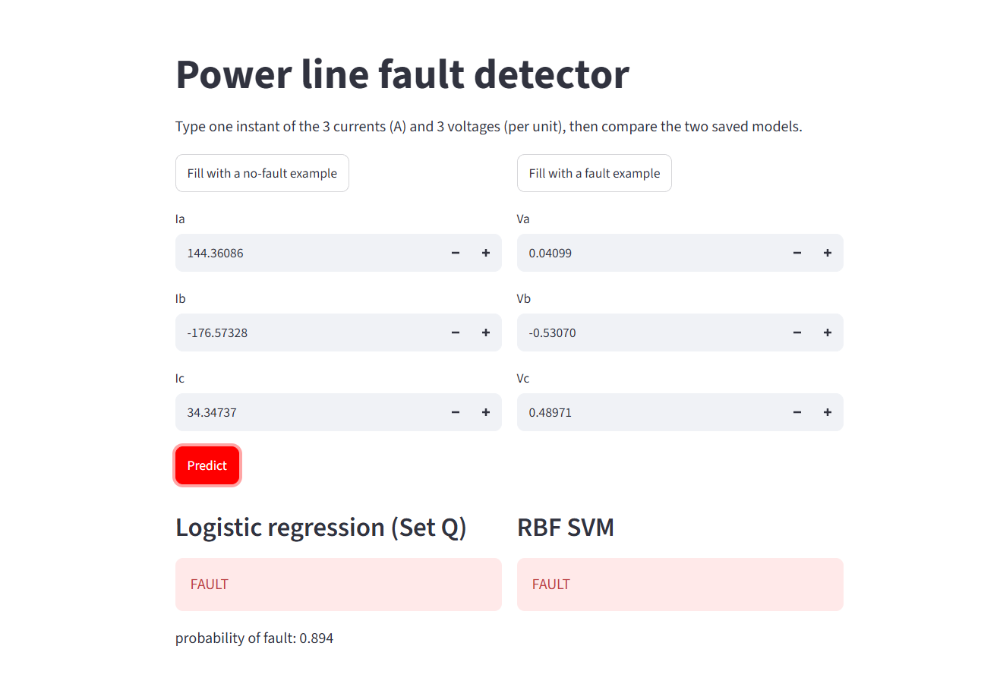

# Power-Line Fault Detection (Logistic Regression + SVM)

Can a straight line detect a fault from one instant of 3 currents and 3 voltages?
Short answer: no. Fix it with squared features (Set Q) or an RBF-kernel SVM.

Team: **<Member 1 AbdulRehman Khan>** and **<Member 2 Bilawal Shehzad>**
Blog: <https://medium.com/@f236066/can-a-straight-line-detect-a-power-line-fault-logistic-regression-vs-svm-c40aa23e8f9c?postPublishedType=initial> 

## Folder layout
```
data/detect_dataset.csv     Kaggle data (download it yourself)
src/load_data.py            the given loader
src/prepare.py              Task 1  clean, split, standardise
src/eda.py                  Task 2  three plots
src/logistic.py             sigmoid, hypothesis, cost, fit_logistic, predict
src/metrics.py              accuracy, confusion_matrix
src/train_logistic.py       Task 3
src/train_svm.py            Task 4
src/test_models.py          Task 5
src/tables.py               small helper that saves tables
results/                    tables, figures, analysis.md, saved models and theta
app/app.py                  Task 7 front end (Streamlit)
```

## How to run everything
```bash
pip install -r requirements.txt
# 1. put detect_dataset.csv inside data/
python src/load_data.py        # check the file loads
python src/prepare.py          # Task 1 (also saves scaler + examples for the app)
python src/eda.py              # Task 2
python src/train_logistic.py   # Task 3
python src/train_svm.py        # Task 4 (can take a few minutes)
python src/test_models.py      # Task 5 (test rows used once)
streamlit run app/app.py       # Task 7 front end
```
Run the commands from the repository root, in this order.

## Front end screenshot


## Results
See `results/` (tables as .csv and .md, figures as .png) and `results/analysis.md`.
